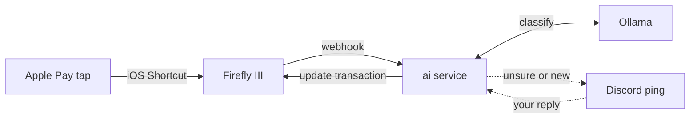

# Firefly III Apple Pay labeller

Self-hosted [Firefly III](https://www.firefly-iii.org/) stack plus a small service that labels Apple Pay
taps with a **local** LLM ([Ollama](https://ollama.com/)) and asks you on Discord when it is unsure.

Tap your phone at a shop, and a few seconds later Firefly holds a clean transaction: `Lunch @ McDonald's`,
with category and budget set, where the bank only gave you `MCDONALDS MAIN STREET 0423`.



## Features

- **Local AI.** Merchant names and amounts go to your own Ollama model, not a cloud API.
- **Learns from your history.** Labels, categories and budgets come from your past Firefly transactions.
  A merchant you have corrected once keeps that label from then on.
- **Asks only when needed.** You get a Discord ping for a new merchant, a new label, an unknown category,
  or low model confidence. Everything else is booked silently.
- **Fix by replying.** Reply to a ping in plain words (`dessert`, `drinks at Starbucks`,
  `merchant Sweet Scoop, budget (none)`) and the transaction is corrected.
- **Meals by the clock.** Restaurants become Breakfast, Lunch or Dinner from the time of the tap.
- **Catches up.** On startup it re-checks unlabelled Apple Pay transactions from the last 7 days, so
  nothing is lost while the service is down.
- **Signed webhooks.** Every Firefly webhook is verified with HMAC-SHA3-256 before it is processed.

## Requirements

- Docker with Docker Compose
- [Ollama](https://ollama.com/) on the host, with a model pulled (default `qwen3:8b`)
- A Discord server where you can add a bot
- An iPhone with Apple Pay and the Shortcuts app
- A private way for the phone to reach Firefly, such as [Tailscale](https://tailscale.com/).
  Do not expose Firefly to the public internet.

## Repository layout

| Path | What it is |
| --- | --- |
| `docker-compose.yml` | Firefly III, MariaDB, data importer, cron, and the `ai` service |
| `ai/bot.py` | Webhook receiver, Ollama classifier, Discord bot |
| `ai/prompt.txt` | Classification and correction prompts (edit to fit your spending) |
| `ai/test_bot.py` | Plain-assert checks for the pure logic |

## Setup

### 1. Environment files

Secrets live in env files next to `docker-compose.yml`. They are git-ignored, so never commit them.

| File | Used by | Where to get it |
| --- | --- | --- |
| `.env` | Firefly III, cron | [Firefly III Docker guide](https://docs.firefly-iii.org/how-to/firefly-iii/installation/docker/) (`.env.example`). Set `TZ` to your time zone. |
| `.db.env` | MariaDB | Same guide (`database.env`) |
| `.importer.env` | Data importer | Firefly III data importer install guide |
| `.ai.env` | `ai` service | Below |

`.ai.env`:

```sh
FIREFLY_TOKEN=          # Firefly Personal Access Token for this service (step 3)
WEBHOOK_SECRET=         # secret of the Firefly webhook (step 3)
DISCORD_TOKEN=          # bot token (step 2)
DISCORD_CHANNEL_ID=     # channel the bot posts in
DISCORD_USER_ID=        # you: the only user whose replies count

# Optional, defaults shown
FIREFLY_URL=http://app:8080                       # Firefly as seen from inside Docker
FIREFLY_PUBLIC_URL=http://localhost               # Firefly as seen from your browser, used in Discord links
OLLAMA_URL=http://host.docker.internal:11434
OLLAMA_MODEL=qwen3:8b
CONFIDENCE_MIN=0.7                                # below this the transaction is flagged for review
LOCALE=                                           # where you spend, e.g. Germany (currency EUR)
```

On Linux, `host.docker.internal` is not defined by default. Set `OLLAMA_URL` to your host's address, or add
`extra_hosts: ["host.docker.internal:host-gateway"]` to the `ai` service.

### 2. Discord bot

1. In the [Discord developer portal](https://discord.com/developers/applications), create an application and
   open **Bot**. Click **Reset Token** and copy it into `DISCORD_TOKEN`, then enable **Message Content Intent**.
2. Under **OAuth2 → URL Generator**, pick scope `bot` with the permissions View Channels, Send Messages,
   Read Message History and Add Reactions. Open the generated URL and add the bot to your server.
3. Create a channel for it. Turn on **Developer Mode** (Discord settings → Advanced), then right-click the
   channel → **Copy Channel ID** for `DISCORD_CHANNEL_ID`, and right-click yourself → **Copy User ID** for
   `DISCORD_USER_ID`.

### 3. Firefly III

1. Start the stack:

   ```sh
   ollama pull qwen3:8b
   docker compose up -d --build
   ```

2. Open <http://localhost>, register, then go to **Administration → Configuration**, tick
   **Allow webhooks** and save.
3. Under **Profile → OAuth → Personal Access Tokens**, create two tokens: one for the `ai` service
   (`FIREFLY_TOKEN`) and one for the iPhone Shortcut. With separate tokens you can revoke the phone's
   without breaking the service.
4. Create the webhook. The `ai` container must be running, because Firefly resolves the URL when you save.
   Either use **Automation → Webhooks** (trigger *after transaction creation*, response
   *transaction details*, delivery *JSON*, URL `http://ai:8000/hook`), or:

   ```sh
   curl -s http://localhost/api/v1/webhooks -H "Authorization: Bearer $FIREFLY_TOKEN" \
     -H "Accept: application/json" -H "Content-Type: application/json" \
     -d '{"title":"Apple Pay AI","active":true,"triggers":["STORE_TRANSACTION"],
          "responses":["TRANSACTIONS"],"deliveries":["JSON"],"url":"http://ai:8000/hook"}'
   ```

5. Copy the webhook's **secret** into `WEBHOOK_SECRET`, then restart the service: `docker compose up -d ai`.

The model picks categories and budgets from the ones that already exist in Firefly, so create the ones you
use. It gets better as your history grows.

### 4. iPhone Shortcut

In Shortcuts, go to **Automation → + → Transaction**, pick your Apple Pay cards, choose **Run Immediately**,
then **New Blank Automation** with these actions:

1. **Dictionary**: map each Wallet card name to its Firefly asset account,
   e.g. `My Visa` → `Main Account`.
2. **Get Dictionary Value** for key *Shortcut Input → Card or Pass*.
3. **Replace Text** in *Shortcut Input → Amount*: regex `[^0-9.]` → nothing. This turns `$1,299.00` into `1299.00`.
4. **Format Date**: *Current Date*, ISO 8601, include time.
5. **Text**, inserting the variables where shown:

   ```json
   {"error_if_duplicate_hash": false, "apply_rules": false, "transactions": [{
     "type": "withdrawal", "date": "[Formatted Date]", "amount": "[Updated Text]",
     "description": "[Merchant]", "source_name": "[Dictionary Value]",
     "destination_name": "Apple Pay pending", "tags": ["applepay"],
     "notes": "raw: [Merchant] | card: [Card or Pass]"}]}
   ```

6. **Get Contents of URL**: `http://<firefly-host>/api/v1/transactions`, method POST, headers
   `Authorization: Bearer <iphone token>`, `Accept: application/json` and `Content-Type: application/json`,
   request body **File** → the Text from step 5.

`<firefly-host>` is the address your phone uses to reach Firefly, such as the PC's Tailscale IP or MagicDNS
name. Keep the `applepay` tag, the `Apple Pay pending` destination and the `raw: … | card: …` notes format:
the service relies on all three.

### 5. Money received (optional)

For eWallet or bank notifications such as "You've received money!" (iOS 27 or later): the
service pings you on Discord, your reply becomes the description, and the model picks the category (a name
you have used before keeps its category). The model picks only from existing categories and leaves it blank
when none fits. Reply `name / category` to set the category yourself: `Allowance from Parents / Allowance`
creates the category if it is new, and that name keeps it from then on. `/ (none)` leaves it blank.

**Automation → + → Notification**, pick the app, filter *Title contains* `received money`, **Run Immediately**:

1. **Match Text** in *Shortcut Input → Message*, regex `\$\s?([\d,]+\.\d{2})`, then **Get Group at Index** 1,
   then **Replace Text** `,` → nothing, then **Set Variable** `Amount`.
2. **Match Text** in *Message*, regex `^(.+?) has transferred`, then **Get Group at Index** 1, then
   **Set Variable** `Payer`.
3. **Format Date** as in step 4 above.
4. **Text**:

   ```json
   {"error_if_duplicate_hash": false, "apply_rules": true, "transactions": [{
     "type": "deposit", "date": "[Formatted Date]", "amount": "[Amount]",
     "description": "[Payer]", "source_name": "[Payer]", "destination_name": "My eWallet",
     "tags": ["ask"], "notes": "raw: [Message] | card: My eWallet"}]}
   ```

5. **Get Contents of URL** as in step 4 above.

The regexes expect a message like `Alex has transferred $5.00 to you.` For wording like `You've received $5.00
from NAME on …`, use the payer regex `from (.+?) on \d`. Swap `\$` for your currency symbol or code, match the
title filter to your app's, and check its notification text before reusing them.

Money you move between your own accounts would count as income: per wallet, add a Firefly rule *source account
is \<your name\>* and *destination account is \<wallet\>* → *convert to transfer* with the sending account.

## Try it without a tap

```sh
curl -s http://localhost/api/v1/transactions -H "Authorization: Bearer $FIREFLY_TOKEN" \
  -H "Accept: application/json" -H "Content-Type: application/json" \
  -d '{"apply_rules":false,"transactions":[{"type":"withdrawal","date":"2026-10-10T21:30:00+00:00",
       "amount":"16.00","description":"SWEET SCOOP LTD","source_name":"Main Account",
       "destination_name":"Apple Pay pending","tags":["applepay"],
       "notes":"raw: SWEET SCOOP LTD | card: My Visa"}]}'
docker logs -f firefly_iii_ai
```

Replace `Main Account` with one of your asset accounts. Expect a Discord ping (it is a new merchant).
Reply `dessert` and the message flips to ✅ fixed.

## Customising

- **Locale:** set `LOCALE` in `.ai.env` so the model knows your country and currency and recognises
  local brands.
- **Prompt:** `ai/prompt.txt` uses generic examples. Change the examples and label rules to match your
  spending.
- **Meal times:** Breakfast 05–11, Lunch 11–17, Dinner otherwise. Change `meal_for` in `ai/bot.py`.
- **Model and threshold:** `OLLAMA_MODEL` and `CONFIDENCE_MIN` in `.ai.env`.

Rebuild after changes: `docker compose up -d --build ai`.

## Tests

```sh
docker compose run --rm --no-deps ai python test_bot.py
```

## Limitations

- Only in-store taps trigger the iOS Transaction automation. Online and in-app Apple Pay payments usually don't.
- Split transactions are skipped, since updating one split would drop the others.
- Discord sees a short summary of each flagged transaction: amount, time, account, label and raw merchant.

## License

[Apache License 2.0](LICENSE), except `docker-compose.yml`, which is adapted from
[firefly-iii/docker](https://github.com/firefly-iii/docker) and remains under
[AGPL-3.0](https://www.gnu.org/licenses/agpl-3.0.html). Firefly III and its data importer are separate
AGPL-3.0 projects, pulled as unmodified images.
